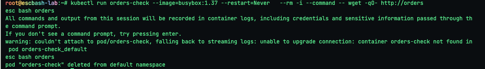

# How to Run the App

## Apply the manifests

```bash
kubectl apply -f deployment.yaml
kubectl apply -f service.yaml
```

## Wait for the rollout

```bash
kubectl rollout status deployment/orders
```

## Check the Deployment

```bash
kubectl get deployment orders
```

## Test from inside the cluster

```bash
kubectl run orders-check --image=busybox:1.37 --restart=Never --rm -i --command -- wget -qO- http://orders
```

Output:


